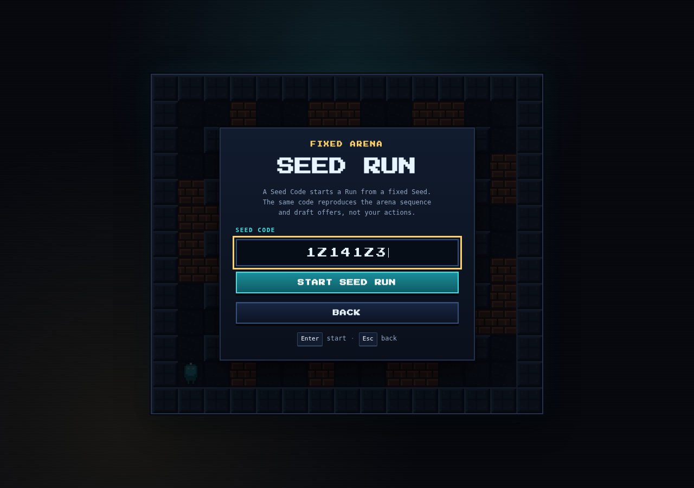
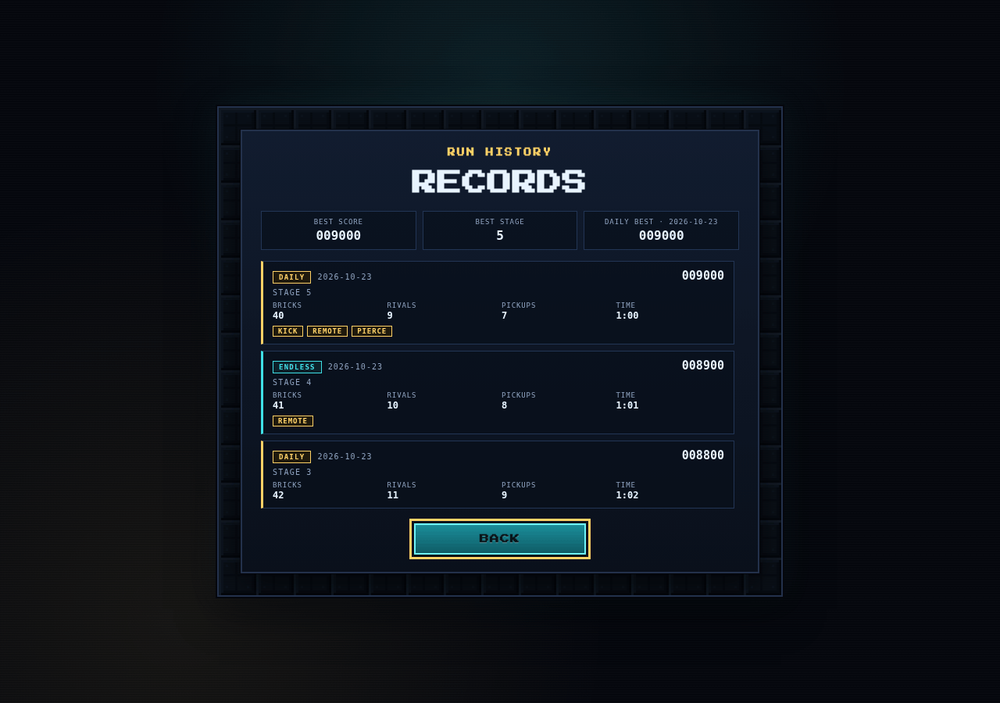
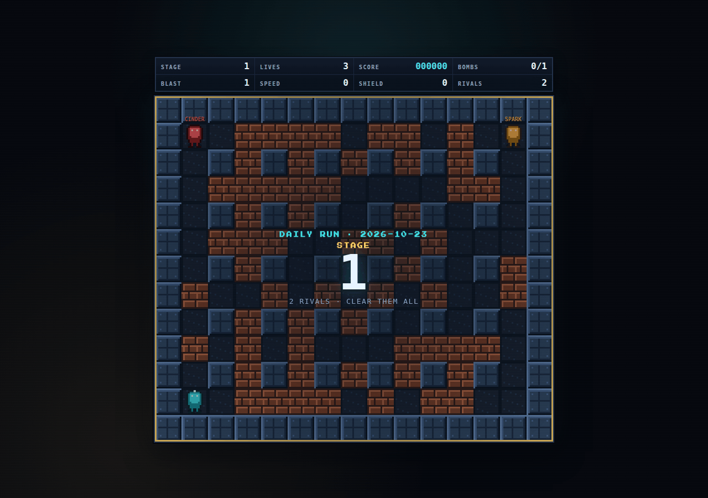

# Bomb Blitz

Bomb Blitz is a browser Bomberman clone: a single-player arena run of maze
combat against AI rivals. It is a static Vite + strict TypeScript + Canvas 2D
game with a deterministic simulation, runtime-generated pixel art, synthesized
Web Audio, local Run Records and Share Links, and no backend.

Clear stage after stage by trapping rivals in cross-shaped blasts, break bricks
to find power-ups, and draft an upgrade between stages. The run ends when your
lives do; your best score, best stage, today's Daily Best, and last 20 runs stay
in the browser. Play a fresh Endless Run, today's Daily Run, or a Seed Run from
a Seed Code someone shared with you.

**Play the live game:** https://gerrcass.github.io/bomberman-clone/


## Setup

Requires Node.js 22.12 or newer.

```bash
npm install
npm run dev
```

Open the URL Vite prints (usually `http://localhost:5173`).

## Controls

| Input | Action |
| --- | --- |
| Arrow keys or WASD | Move up, down, left, right |
| Space | Place a bomb |
| X | Detonate your live bombs early (Remote Detonation) |
| Escape or P | Pause / resume, or close Records, Settings, How to Play, and the Seed Run setup |
| M | Mute or unmute all audio |
| Arrow keys, 1–3 | Focus and pick an upgrade card |
| Tab, Enter | Move focus and activate menu buttons |

Every screen and action is keyboard-operable. Movement is tile-to-tile with
smooth interpolation: a held direction keeps moving, a perpendicular tap is
buffered for the next tile center, and reversing mid-step turns around
immediately. Walls, bricks, and bombs block entry.

## The run

Each run starts with 3 lives, one bomb, blast range 1, base speed, no shield,
a 1.0× score multiplier, and a 2200 ms fuse.

- **Bombs** detonate in a cross, stop at walls, destroy the first brick in each
  direction, and chain through touching bombs. A bomb placed mid-step lands on
  the tile you are leaving.
- **Bricks** hide power-ups. About 55% of eligible bricks contain one: extra
  bomb, fire, speed, or shield. Pickups survive blasts until collected.
- **Rivals** build danger maps, flee live and predicted blasts, hunt the player,
  bomb through bricks, and collect power-ups. Cinder is aggressive, Spark is
  balanced, and Vex is cautious. Stages 1–3 field two rivals; stage 4 and later
  field three, with speed, reaction time, bomb capacity, and blast range scaling
  smoothly and without a final stage.
- **Shields** absorb one lethal blast or contact hit and grant brief
  invulnerability.
- **Losing a life** respawns you at the safest corner after a short delay with
  temporary invulnerability. Losing the last life ends the run immediately,
  even if the last rival dies in the same tick.
- **Clearing a stage** awards `1000 + 250 × (stage − 1)` plus a time bonus of
  `max(0, 1500 − 20 × elapsed seconds)`, shows a breakdown, and opens a draft of
  three upgrades. Each intermission offers at most one **Technique** and fills
  the other slots with stat upgrades. Stat upgrades cap at Extra Bomb 8, Fire 8,
  Speed 5, Shield 2, Extra Life 5, Score Multiplier 5, and Short Fuse 4; Arena
  Cache (+750 points) takes any stat slot left over (two when a technique is
  offered, three otherwise).
- **Techniques** are upgrades that change how your bombs behave; each can be
  owned once per run. Bomb Kick sends a resting bomb sliding when you walk into
  it, stopping at terrain, another bomb, or a bomber. Remote Detonation lets you
  press X to trigger every live bomb you own; the fuse still runs as a safety.
  Piercing Blast breaks every brick in range instead of stopping at the first.
  Rivals keep classic bombs.
- **Scoring:** bricks 10, pickups 25, rival defeats 500, plus stage-clear and
  time bonuses. The multiplier applies to every award.

The game auto-pauses when the tab becomes hidden and returns paused. Ending a
run by game over or confirmed quit records it once and updates the profile.

## Run modes, records, and sharing

- **Endless Run** is the default mode. Play starts a fresh seeded run.
- **Daily Run** seeds the arena from your local calendar date: the `YYYY-MM-DD`
  key is hashed to a stable unsigned 32-bit seed, so every attempt on the same
  date uses the same arena sequence. Daily Runs are replayable all day. The
  **Daily Best** is the highest score for the current local date and never
  carries over to a new date. The seed is captured when the run starts, so
  midnight does not change a run in progress.
- **Seed Run** starts from a **Seed Code** entered on the title or opened from a
  **Share Link**. The same Seed reproduces the arena sequence and draft offers,
  given the same choices and actions. It does not replay your inputs, so a
  shared Seed is a shared challenge, not a ghost of the original run.
- **Seed Codes** are uppercase base36, 1–7 significant characters. Input accepts
  lowercase letters and surrounding whitespace, leading zeroes are allowed, `0`
  is a valid Seed, and a code above the unsigned 32-bit range (`0xFFFFFFFF`) is
  rejected. There is no decimal Seed format, so a code always means one Seed.
- All three Run Modes use the same run rules, upgrades, Techniques, and scoring.
  Every finished run updates the all-time best score, best stage, and runs
  played. Only a Daily Run updates the Daily Best; a Seed Run leaves it alone.
- **Run History** keeps the 20 most recent **Run Records**, newest first. Each
  record stores its Run Mode, Seed, finish time, Daily Run date, score, stage,
  bricks, rivals, pickups, elapsed time, and owned Technique IDs.
- **Records** opens from the title or game over. It shows the all-time best
  score and stage, today's Daily Best, and every Run Record with its mode badge,
  local date, score, stage, run statistics, Technique chips, and, when the
  record has one, its Seed Code. **Replay seed** starts a Seed Run with that
  Seed. Records migrated from v2 have no Seed and show neither the code nor the
  action. Back or Escape returns to the title or game over. The title also shows
  today's Daily Best and the last run.
- **Game over** names the Run Mode and shows the Seed Code for every new run.
  **Copy Seed Link** builds a link from the current page URL with
  `?seed=<Seed Code>`. It preserves the deployed path, every other query
  parameter, and the hash, so the link works at a domain root or under a
  subpath; any existing `seed` values are replaced with the canonical Seed Code.
  It reports success in a status line, or reveals the link in a selectable field
  when the Clipboard API is unavailable. Opening a link fills the Seed Run setup
  and focuses Start; it never auto-starts a run. The `seed` parameter is removed
  from the address bar after it opens the setup, and an invalid value is
  ignored.

Retry Run keeps the same Seed for a Seed Run, reuses the captured date seed for
a Daily Run, and draws a fresh Seed for an Endless Run. A new local date starts
a new Daily Run and an empty Daily Best while older daily records stay in Run
History.







## Settings and persistence

How to Play and Settings are reachable from the title screen; Settings is also
reachable from the pause menu. Sound, Music, Screen Shake, Reduced Motion, and
High Contrast save immediately and survive refresh. High Contrast strengthens
terrain and hazard separation; Reduced Motion removes screen shake and
non-essential animation while keeping gameplay state readable.

The profile is versioned and stored in `localStorage` under
`bomb-blitz.profile.v3`, the authoritative key. When v3 is absent, the
`bomb-blitz.profile.v2` key is read once and mapped to v3: its high score, best
stage, runs played, settings, Run History, and Daily Best survive, and every
migrated record has no Seed. When v2 is also absent, `bomb-blitz.profile.v1` is
read once: its bests and settings migrate with an empty Run History and no
Daily Best. The migration is one-way: both older keys are left untouched, and
saves write only v3. A malformed v3 falls back to defaults rather than
resurrecting v2 or v1; a malformed v2 does not fall back to v1.

Every profile and Run History field is validated independently. Malformed
history entries are dropped without losing the rest of the profile, numeric
fields clamp to non-negative integers, unknown Run Modes are dropped, unknown
Technique IDs are ignored, and invalid settings fall back per field. A Seed
must be an unsigned 32-bit integer or absent; a Seed Run record without a valid
Seed is dropped. Invalid JSON or a blocked/full `localStorage` never prevents
play, and storage write failures are swallowed.

## Project structure

```text
index.html                  App shell and menu screens
src/main.ts                 Browser entry point
src/styles.css              Arcade theme, responsive layout, accessibility modes
src/game/                   Deterministic simulation (no DOM, Canvas, or audio)
  arena.ts                  Seeded arena generation and ASCII fixtures
  movement.ts               Tile-to-tile movement and input buffering
  powerups.ts               Hidden power-up generation, caps, and weights
  stage.ts                  Stage seam: bombs, blasts, rivals, lives, pickups
  ai.ts                     Danger maps, escape routes, rival decisions
  techniques.ts             Technique definitions, ownership, and caps
  upgrades.ts               Upgrade pool, draft, caps, and stat helpers
  run.ts                    Endless run loop, scoring, intermission state
src/render/                 Runtime pixel art, particles, camera, Canvas renderer
src/audio/                  Synthesized SFX and chiptune loop
src/app/                    Browser shell: loop, input, screens, persistence, HUD
  daily.ts                  Local YYYY-MM-DD date key and stable Daily Run seed
  game.ts                   Screen state, Records, Seed Run setup, game over, sharing
  profile.ts                Profile v3, v2/v1 migration, Run History, Daily Best
  seed.ts                   Seed Code formatting/parsing and Share Link helpers
  session.ts                Run Mode labels, retry seeding, replay sessions
.github/workflows/ci.yml    Push and pull-request checks
.github/workflows/pages.yml GitHub Pages deployment
```

Game tests never touch a browser: they build stages from seeds or ASCII arena
fixtures and drive the fixed 1/60-second simulation directly. Renderer and app
tests cover snapshotting, profile persistence, Seed Codes and Share Links, and
the daily date/seed.

## Commands

| Command | Purpose |
| --- | --- |
| `npm run dev` | Start the Vite dev server |
| `npm run build` | Typecheck and build the static production bundle |
| `npm run preview` | Serve the production build |
| `npm run test` | Run Vitest once |
| `npm run typecheck` | Run `tsc --noEmit` |
| `npm run lint` | Run Biome checks |
| `npm run format` | Apply Biome formatting and safe fixes |
| `npm run check` | Lint, typecheck, test, and build |

## Testing

Vitest covers arena generation invariants (dimensions, border, lattice pillars,
spawn clearance, brick density, seed reproducibility), movement rules, bomb
placement and capacity, fuse timing, blast geometry and lifetime, wall and brick
stopping, chain reactions, hidden power-up generation and guarantees, reveal
and collection, stat caps, shield absorption, lives and respawns, rival danger
maps and decisions, rival contact and defeats, stage clear, stage scaling,
technique ownership and the one-technique draft, Bomb Kick slides and blockers,
Remote Detonation triggers, Piercing Blast rays, upgrade drafts and caps,
scoring and multiplier rounding, run stats, profile defaults and malformed data,
profile v3 validation, v2 and v1 migration, Run History cap and ordering, Daily
Best transitions, Seed Code formatting and parsing across the 32-bit boundary,
Share Link construction and removal, seed-mode run determinism, Run Mode labels,
retry seeding, replay sessions, the local date key and stable daily seed,
daily-mode run determinism, persistence, and fixed-seed determinism.

Scenarios use small ASCII arena fixtures so each case reads as a maze:

```ts
const stage = createStage({
  seed: 1,
  arena: ['#######', '#.....#', '#..#..#', '#P....#', '#.....#', '#######'],
});
tickStage(stage, { direction: 'right' });
```

Each tick is exactly 1/60 second. `getStageState` exposes bombs, blasts,
power-ups, bomber positions, techniques, and run stats to the renderer, HUD, and
tests. Events are additive: movement, bomb, blast, brick, pickup, shield, hit,
respawn, rival, kicked bomb, stage-clear, and game-over events all flow through
the tick return value.

## Static build and deployment

`npm run build` writes a self-contained static site to `dist/`. The Vite base is
relative, so the same output works at a domain root or under a subpath.
`npm run preview` serves the built output locally.

The app fetches nothing at runtime: sprites are generated from pixel matrices,
audio is synthesized with Web Audio, and only a bundled display font is
packaged.

The live site is deployed at
**https://gerrcass.github.io/bomberman-clone/**.

`.github/workflows/pages.yml` builds the site and publishes `dist/` to GitHub
Pages on every push to `main`, and can be run manually from the Actions tab.
For a fork, enable **Settings → Pages → Source: GitHub Actions** once for the
repository. Any static host can serve the same `dist/` directory instead.

## CI

GitHub Actions runs on every push and pull request with Node 22:

```text
npm ci
npm run check
```

Created in [T3 Code](https://t3.codes).
