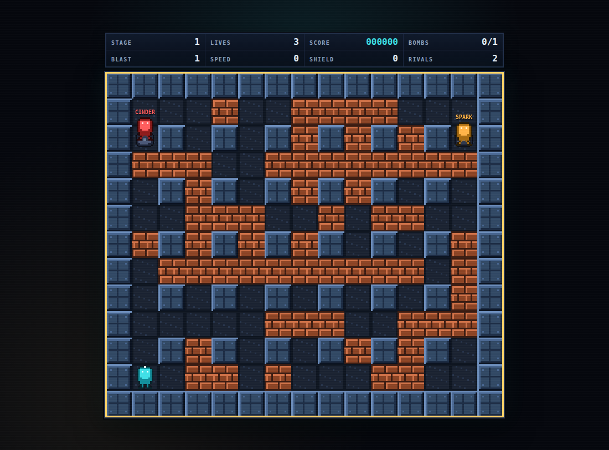

# Bomb Blitz

Bomb Blitz is a browser Bomberman clone: a single-player, endless arena run of
maze combat against AI rivals. It is a static Vite + strict TypeScript + Canvas
2D game with a deterministic simulation, runtime-generated pixel art,
synthesized Web Audio, and no backend.

Clear stage after stage by trapping rivals in cross-shaped blasts, break bricks
to find power-ups, and draft an upgrade between stages. The run ends when your
lives do; your best score and best stage stay in the browser.

**Play the live game:** https://gerrcass.github.io/bomberman-clone/



## Setup

Requires Node.js 22.12 or newer.

```bash
npm install
npm run dev
```

Open the URL Vite prints (usually `http://localhost:5173`).

## Controls

| Input | Action |
| --- | --- |
| Arrow keys or WASD | Move up, down, left, right |
| Space | Place a bomb |
| Escape or P | Pause / resume, or back out of a menu |
| M | Mute or unmute all audio |
| Arrow keys, 1–3 | Focus and pick an upgrade card |
| Tab, Enter | Move focus and activate menu buttons |

Every screen and action is keyboard-operable. Movement is tile-to-tile with
smooth interpolation: a held direction keeps moving, a perpendicular tap is
buffered for the next tile center, and reversing mid-step turns around
immediately. Walls, bricks, and bombs block entry.

## The run

Each run starts with 3 lives, one bomb, blast range 1, base speed, no shield,
a 1.0× score multiplier, and a 2200 ms fuse.

- **Bombs** detonate in a cross, stop at walls, destroy the first brick in each
  direction, and chain through touching bombs. A bomb placed mid-step lands on
  the tile you are leaving.
- **Bricks** hide power-ups. About 55% of eligible bricks contain one: extra
  bomb, fire, speed, or shield. Pickups survive blasts until collected.
- **Rivals** build danger maps, flee live and predicted blasts, hunt the player,
  bomb through bricks, and collect power-ups. Cinder is aggressive, Spark is
  balanced, and Vex is cautious. Stages 1–3 field two rivals; stage 4 and later
  field three, with speed, reaction time, bomb capacity, and blast range scaling
  smoothly and without a final stage.
- **Shields** absorb one lethal blast or contact hit and grant brief
  invulnerability.
- **Losing a life** respawns you at the safest corner after a short delay with
  temporary invulnerability. Losing the last life ends the run immediately,
  even if the last rival dies in the same tick.
- **Clearing a stage** awards `1000 + 250 × (stage − 1)` plus a time bonus of
  `max(0, 1500 − 20 × elapsed seconds)`, shows a breakdown, and opens a draft of
  three upgrades. Stat upgrades cap at Extra Bomb 8, Fire 8, Speed 5, Shield 2,
  Extra Life 5, Score Multiplier 5, and Short Fuse 4; when fewer than three stat
  upgrades remain, Arena Cache (+750 points) fills the draft.
- **Scoring:** bricks 10, pickups 25, rival defeats 500, plus stage-clear and
  time bonuses. The multiplier applies to every award.

The game auto-pauses when the tab becomes hidden and returns paused. Ending a
run by game over or confirmed quit updates the profile's high score, best
stage, and runs played.

## Settings and persistence

How to Play and Settings are reachable from the title screen; Settings is also
reachable from the pause menu. Sound, Music, Screen Shake, Reduced Motion, and
High Contrast save immediately and survive refresh. High Contrast strengthens
terrain and hazard separation; Reduced Motion removes screen shake and
non-essential animation while keeping gameplay state readable.

The profile is versioned and stored in `localStorage` under
`bomb-blitz.profile.v1`. Invalid JSON, wrong types, and out-of-range values fall
back to defaults without blocking startup, and storage write failures are
swallowed so gameplay continues.

## Project structure

```text
index.html                  App shell and menu screens
src/main.ts                 Browser entry point
src/styles.css              Arcade theme, responsive layout, accessibility modes
src/game/                   Deterministic simulation (no DOM, Canvas, or audio)
  arena.ts                  Seeded arena generation and ASCII fixtures
  movement.ts               Tile-to-tile movement and input buffering
  powerups.ts               Hidden power-up generation, caps, and weights
  stage.ts                  Stage seam: bombs, blasts, rivals, lives, pickups
  ai.ts                     Danger maps, escape routes, rival decisions
  upgrades.ts               Upgrade pool, draft, caps, and stat helpers
  run.ts                    Endless run loop, scoring, intermission state
src/render/                 Runtime pixel art, particles, camera, Canvas renderer
src/audio/                  Synthesized SFX and chiptune loop
src/app/                    Loop, input, screens, settings, profile, HUD
.github/workflows/ci.yml    Push and pull-request checks
.github/workflows/pages.yml GitHub Pages deployment
```

Game tests never touch a browser: they build stages from seeds or ASCII arena
fixtures and drive the fixed 1/60-second simulation directly. Renderer and app
tests cover snapshotting and profile persistence.

## Commands

| Command | Purpose |
| --- | --- |
| `npm run dev` | Start the Vite dev server |
| `npm run build` | Typecheck and build the static production bundle |
| `npm run preview` | Serve the production build |
| `npm run test` | Run Vitest once |
| `npm run typecheck` | Run `tsc --noEmit` |
| `npm run lint` | Run Biome checks |
| `npm run format` | Apply Biome formatting and safe fixes |
| `npm run check` | Lint, typecheck, test, and build |

## Testing

Vitest covers arena generation invariants (dimensions, border, lattice pillars,
spawn clearance, brick density, seed reproducibility), movement rules, bomb
placement and capacity, fuse timing, blast geometry and lifetime, wall and brick
stopping, chain reactions, hidden power-up generation and guarantees, reveal
and collection, stat caps, shield absorption, lives and respawns, rival danger
maps and decisions, rival contact and defeats, stage clear, stage scaling,
upgrade drafts and caps, scoring and multiplier rounding, run stats, profile
defaults and malformed data, persistence, and fixed-seed determinism.

Scenarios use small ASCII arena fixtures so each case reads as a maze:

```ts
const stage = createStage({
  seed: 1,
  arena: ['#######', '#.....#', '#..#..#', '#P....#', '#.....#', '#######'],
});
tickStage(stage, { direction: 'right' });
```

Each tick is exactly 1/60 second. `getStageState` exposes bombs, blasts,
power-ups, bomber positions, and run stats to the renderer, HUD, and
tests. Events are additive: movement, bomb, blast, brick, pickup, shield, hit,
respawn, rival, stage-clear, and game-over events all flow through the tick
return value.

## Static build and deployment

`npm run build` writes a self-contained static site to `dist/`. The Vite base is
relative, so the same output works at a domain root or under a subpath.
`npm run preview` serves the built output locally.

The app fetches nothing at runtime: sprites are generated from pixel matrices,
audio is synthesized with Web Audio, and only a bundled display font is
packaged.

The live site is deployed at
**https://gerrcass.github.io/bomberman-clone/**.

`.github/workflows/pages.yml` builds the site and publishes `dist/` to GitHub
Pages on every push to `main`, and can be run manually from the Actions tab.
For a fork, enable **Settings → Pages → Source: GitHub Actions** once for the
repository. Any static host can serve the same `dist/` directory instead.

## CI

GitHub Actions runs on every push and pull request with Node 22:

```text
npm ci
npm run check
```

Created in [T3 Code](https://t3.codes).
